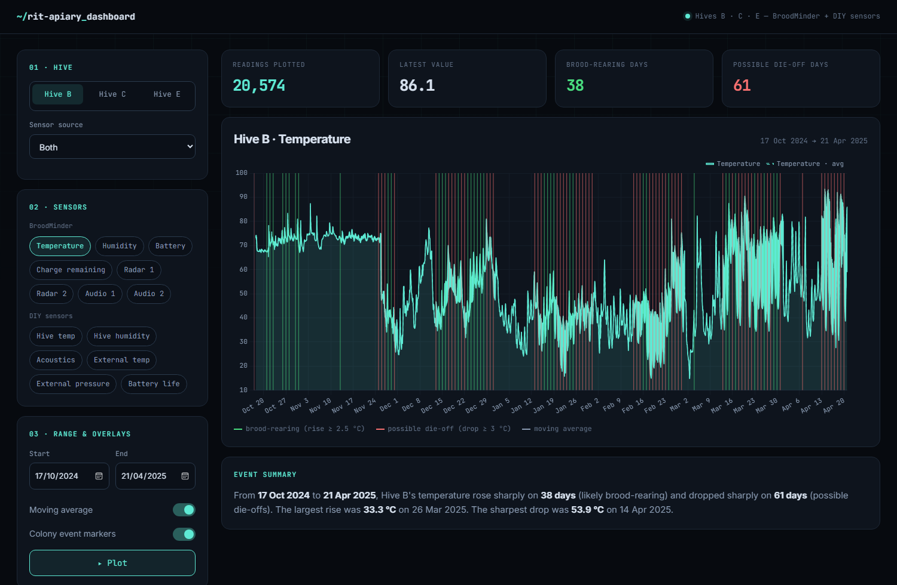
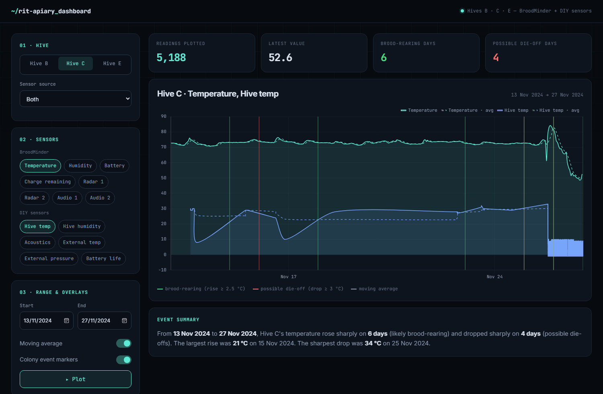

# RIT Apiary Data Dashboard

An interactive dashboard for monitoring beehive health at the RIT Apiary, built with **MongoDB, Flask and Chart.js**.
It brings together **BroodMinder** and **DIY** sensor data for Hives B, C and E, plots any combination of sensors
over time, and flags likely colony events automatically.



## Features

- **MongoDB time-series collection:** `hive_readings` uses `timestamp` as the time field and `hive` as the meta field,
  so range queries per hive stay fast. The importer loads about **95,000 readings** from both sources.
- **Data import:** `import.py` cleans and loads the BroodMinder CSV exports (temperature, humidity, battery, radar, audio)
  and the DIY sensor logs (hive temperature, humidity, acoustics, external temperature and pressure, battery).
- **Interactive controls:** choose a hive, a sensor source (BroodMinder, DIY or both), any set of sensors and a date range.
- **Colony event detection:** a sharp temperature rise (≥ +2.5) is marked as likely brood-rearing, and a sharp drop
  (≤ −3) as a possible die-off. Events are reduced to the strongest one per day and drawn on the chart.
- **Moving-average overlay** to smooth noisy sensors.
- **At-a-glance numbers:** readings plotted, latest value, and brood-rearing and die-off day counts.
- **Plain-language summary:** for example, *"From Nov 13 to Nov 27, Hive C's temperature rose sharply on 6 days
  (likely brood-rearing) and dropped sharply on 4 days (possible die-offs)."*
- **Shareable views:** URL parameters preset the view, for example
  `/?hive=C&sensors=temperature&sensors=hive_temp&start=2024-11-13&end=2024-11-27`.

## Screenshots

### Two-week view: BroodMinder and DIY sensors together, with moving averages and event markers


## Running it locally

1. Install and start [MongoDB Community Server](https://www.mongodb.com/try/download/community) on `localhost:27017`.
2. Install the Python packages:
   ```bash
   pip install -r requirements.txt
   ```
3. Load the sensor data into the `apiary` database:
   ```bash
   python import.py
   ```
4. Start the dashboard and open http://127.0.0.1:5000:
   ```bash
   python apiary_dashboard/app.py
   ```

## Project structure

```
import.py                    # cleans and loads BroodMinder CSVs and DIY logs into MongoDB
2025-04-22/                  # BroodMinder CSV exports
hive b.txt, hive c.txt, ...  # DIY sensor logs
apiary_dashboard/
  app.py                     # Flask app: /data endpoint and event detection
  templates/index.html       # dashboard UI (Chart.js)
  static/style.css
```
