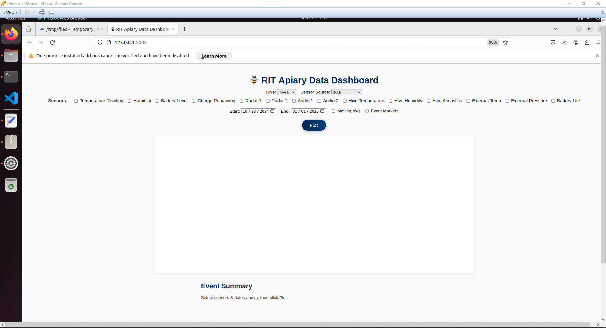
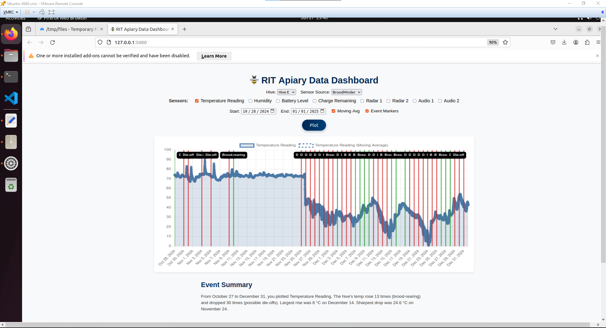
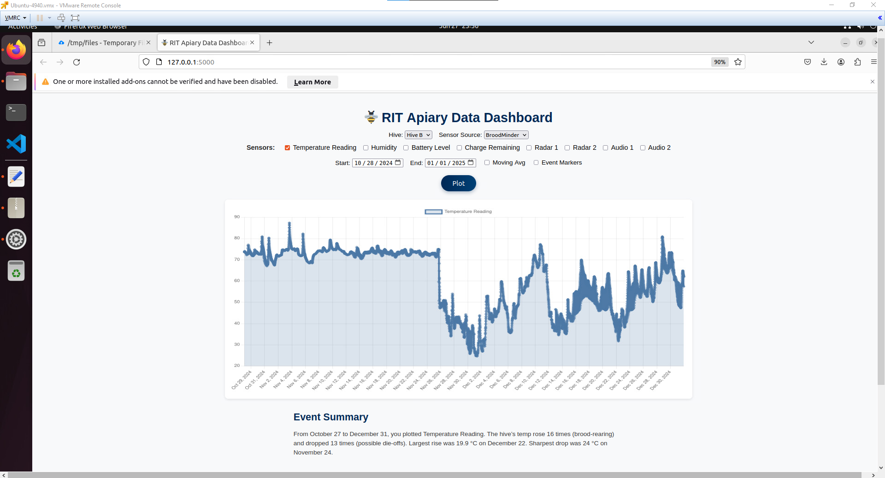

# 🐝 ISTE-438 Bonus Project: RIT Apiary Data Dashboard

## Summary of Work Completed

For the bonus project, I built a complete interactive data dashboard to visualize RIT Apiary sensor data using MongoDB, Flask, and Chart.js. The app integrates **BroodMinder** and **DIY sensors** across Hives B, C, and E, offering time-based insight into hive conditions such as temperature, humidity, and acoustics.

### Features Implemented

- **MongoDB Time-Series Collection**
  - Created `hive_readings` with `timestamp` as `timeField` and `hive` as `metaField`.
  - Enables efficient time-based querying and aggregation.

- **Data Import**
  - Parsed and imported all **BroodMinder CSVs** (temperature, humidity, battery, radar, audio).
  - Parsed **DIY sensor logs** (hive temperature, acoustics, external pressure, etc.).
  - Used custom `import.py` script for cleaning and formatting.

- **Interactive Flask App**
  - User can:
    - Choose Hive (B, C, E) and Source (BroodMinder, DIY, or Both).
    - Select individual sensors to graph.
    - Filter by date range (via date picker).
    - Toggle **Moving Average** smoothing.
    - Toggle **Colony Event Detection** overlay.

- **Colony Event Detection**
  - Detects:
    - **Brood-rearing** → sharp temp rise (≥ +2.5°C).
    - **Die-offs** → sharp drop (≤ -3°C).
  - Annotated on the chart with:
    - Green lines for brood-rearing.
    - Red lines for die-offs.

- **User-Friendly Summary**
  - After plotting, an auto-generated summary appears:
    - "From Oct 28 to Nov 28, Hive B’s temperature rose 8 times and dropped 5 times..."
  - Language is readable for non-experts (no jargon).

- **Polished UI**
  - Aesthetic improvements:
    - Modern layout, spacing, and font use.
    - Styled dropdowns, checkboxes, and button.
    - Responsive layout.
    - Clearly grouped sensors by source (BroodMinder vs DIY).
    - Friendly date format: `Nov 12, 2024`.

---

## 📸 Screenshots

### Main Page UI
> Shows clean layout, Hive + Source selectors, sensors, and date range.

---

### Hive Temperature with Moving Avg and Event Markers
> Temperature chart with green brood-rearing and red die-off markers, and moving average overlay.

---

### Example BroodMinder Hive Chart
> BroodMinder sensor data plotted with multiple variables.

---

### Generated Summary Paragraph
> Summary written in simple language explaining the hive activity.

---

## Bonus Points Expected: **3**

I believe this project meets the full 3-point bonus criteria because:

- ✅ Designed a MongoDB time-series model.
- ✅ Imported both BroodMinder and DIY datasets.
- ✅ Built an interactive Flask + Chart.js visualization dashboard.
- ✅ Added advanced features:
  - Automatic colony event detection.
  - Moving average overlay.
  - Clean UI with responsive layout.

---

### Thank you!
